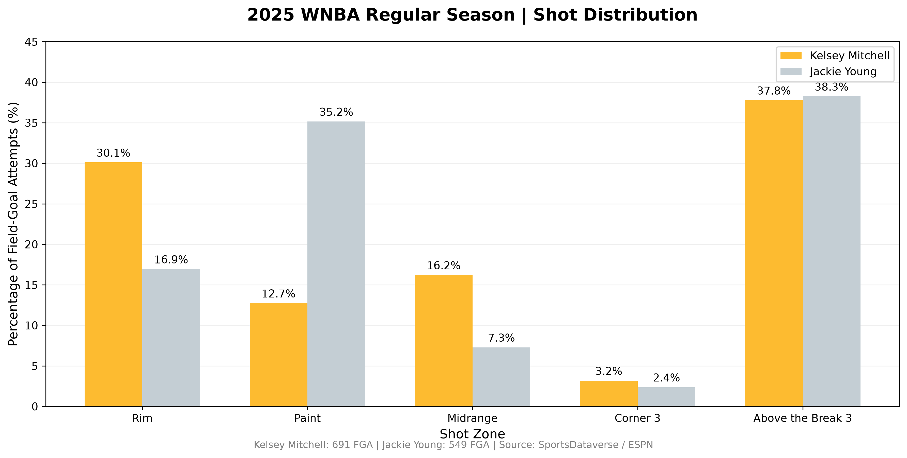
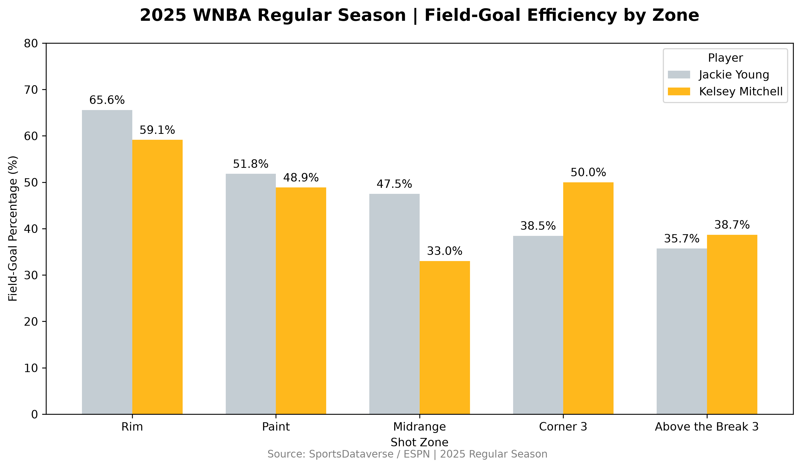
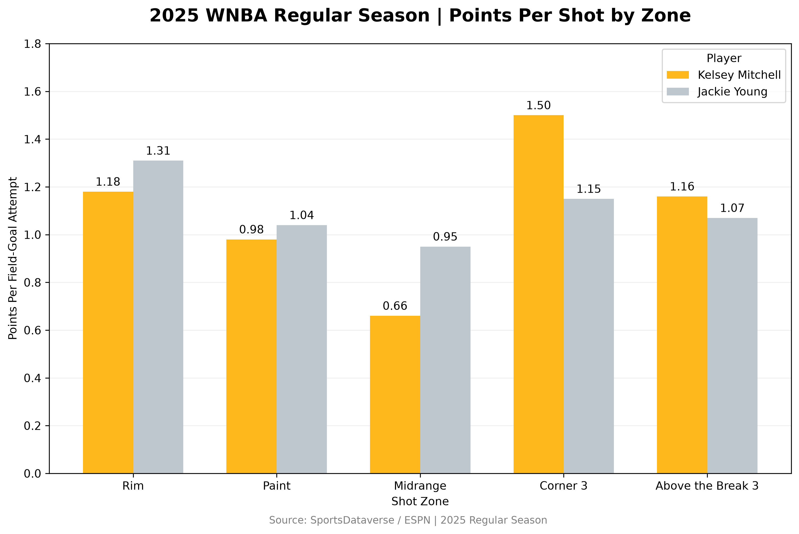
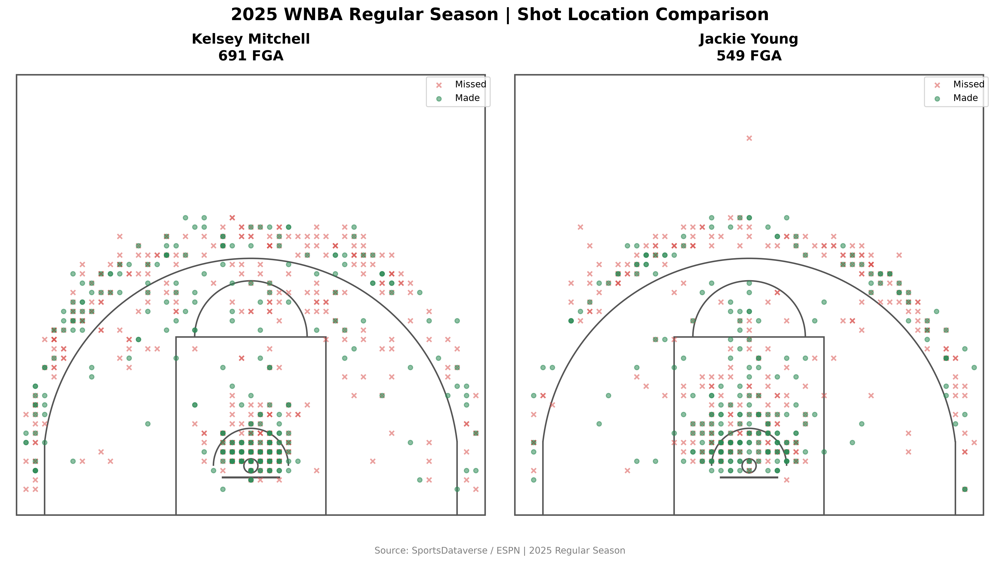

# 2025 WNBA Shot Profile Analysis

Kelsey Mitchell vs. Jackie Young

## Project Overview

This project compares the offensive shot profiles of Kelsey Mitchell and Jackie Young during the 2025 WNBA regular season using Python and play-by-play shot data.

The objective is to explore how two high-level WNBA guards differ in shot selection, field-goal efficiency, and scoring value across different areas of the basketball court.

Rather than relying exclusively on traditional box-score statistics, this analysis examines where shots occur, how frequently each player attempts them, and how efficiently those attempts translate into points.

## Research Questions

How does shot selection differ between Kelsey Mitchell and Jackie Young?

Which areas of the court generate the greatest scoring efficiency for each player?

How does three-point shooting compare with interior and midrange production?

What offensive tendencies can be identified through spatial shot data?

## Tools and Technologies

Python

pandas

NumPy

Matplotlib

Visual Studio Code

GitHub

How to Run the Project

Clone or download this repository.

Open the project folder in a terminal.

Install the required Python libraries:

pip install -r requirements.txt

Ensure the required CSV datasets are available in the data/ folder.

Run the analysis:

python shot_profile_analysis.py

The script processes the shot data, calculates shooting metrics, and generates four visualizations in the visualizations/ directory.

## Data Source

Shot and schedule data were obtained from SportsDataverse / ESPN for the 2025 WNBA season.

The analysis focuses on regular-season field-goal attempts, excluding free throws.

## Dataset summary:

Player

Games

Field-Goal Attempts

Kelsey Mitchell

44

691

Jackie Young

44

549

Total

1,240

## Methodology

Shot events were filtered by player and regular-season game identifiers. Free-throw events were excluded, and shot coordinates were normalized to a common half-court orientation.

Each field-goal attempt was assigned to one of five project-defined zones:

Rim

Paint

Midrange

Corner Three

Above-the-Break Three

Three primary metrics were calculated:

Shot Frequency (%) = Zone Attempts / Total Field-Goal Attempts × 100

Field-Goal Percentage (%) = Made Field Goals / Field-Goal Attempts × 100

Points Per Shot = Total Points Scored / Field-Goal Attempts

## Visualizations

### 1. Shot Distribution by Zone

### 2. Field-Goal Efficiency by Zone

### 3. Points Per Shot by Zone

#### 4. Shot Location Comparison

## Key Findings

Kelsey Mitchell: Perimeter Scoring Value

Mitchell generated 1.16 points per attempt on above-the-break threes across 261 attempts. Her corner-three efficiency reached 1.50 points per attempt, although that result came from a smaller sample of 22 shots.

Her midrange attempts produced 0.66 points per shot across 112 attempts, substantially below her three-point production.

Jackie Young: Interior Efficiency

Young converted 65.6% of her rim attempts and generated 1.31 points per shot in that zone.

She also outperformed Mitchell in field-goal efficiency across the project's rim, paint, and midrange categories.

Different Shot Profiles

Mitchell attempted 30.1% of her field goals from the rim zone, compared with Young's 16.9%.

Young attempted 35.2% of her field goals from the paint zone, compared with Mitchell's 12.7%.

Both players devoted approximately 38% of their attempts to above-the-break threes.

These differences suggest distinct offensive shot-selection patterns, even though both players rely substantially on perimeter opportunities.

## Limitations

Shot zones are custom classifications derived from coordinate-based rules, not official WNBA shot-zone labels.

A small number of attempts may fall near zone boundaries, introducing classification uncertainty.

Corner-three samples are relatively small and should not be overinterpreted.

Overlapping shot markers may obscure shot density in the spatial visualizations.

Points per shot excludes free throws and does not represent complete possession efficiency.

The analysis is descriptive and does not control for defensive pressure, shot difficulty, game context, or teammate influence.

## Conclusion

Kelsey Mitchell and Jackie Young demonstrate different offensive tendencies in the 2025 WNBA regular-season data.

Mitchell's perimeter efficiency, particularly above the break, is an important component of her scoring profile. Young demonstrates stronger observed conversion rates across the project's interior and midrange zones.

Together, shot frequency, shooting accuracy, and points per attempt provide a more complete picture of these differences than any single statistic alone.

Future Improvements

Potential extensions include:

Shot-density heatmaps

Game-by-game shooting trends

Shot-type and defender-context analysis

More precise coordinate-based zone validation

Expected points models incorporating shot location and context

## Author 

Ashonti Sweat

Basketball Analytics Portfolio Project

Focus: Python, sports data analysis, data visualization, and basketball strategy.